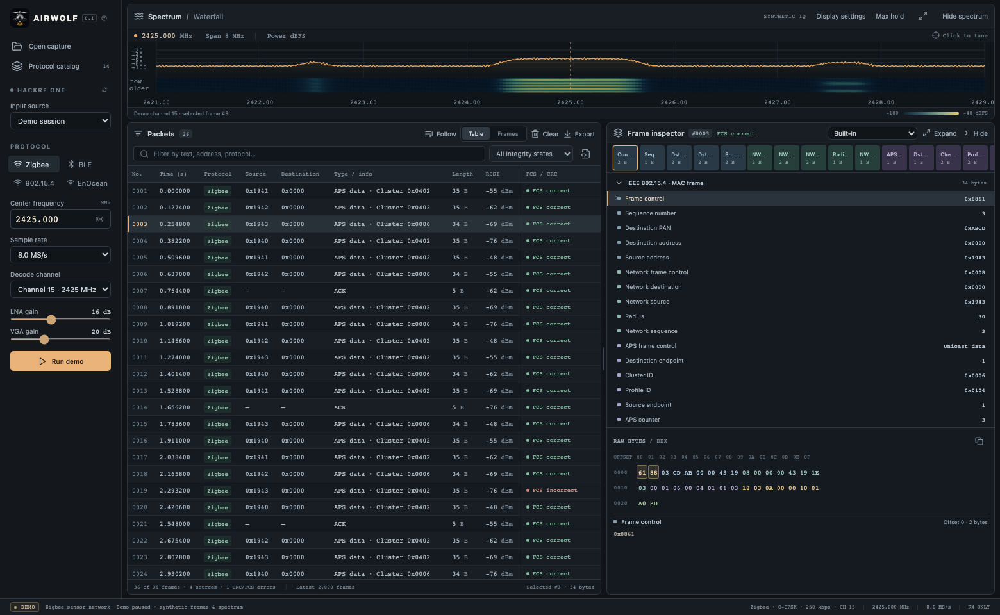

<p align="center"></p>

# Airwolf

**Spectrum, packets, and the bytes behind them.** Airwolf is a desktop HackRF One spectrum and packet analyzer for Windows, Debian Linux and macOS.

[Download preview builds](https://github.com/mikro-design/airwolf/releases) · [User guide](docs/user-guide.md) · [Build from source](docs/development.md) · [Standards references](docs/standards-references.md) · [Report a problem](https://github.com/mikro-design/airwolf/issues)



## Try it

1. Download the installer for your computer from **Releases**: Windows x64 `.exe`, Debian/Ubuntu x64 `.deb`, or macOS `.dmg` for Apple Silicon (`arm64`) / Intel (`x64`). macOS builds target macOS 15 or newer; Debian builds target Debian 12+ and Ubuntu 24.04+.
2. Install and open **Airwolf**. The paused demo works without radio hardware. Choose **Run demo** to explore packet selection, decoded fields, strings and CRC status.
3. For live reception, connect HackRF One, choose **HackRF One · USB**, select **BLE → CH 37 / 2402 MHz**, use **8 MS/s**, **LNA 24 dB**, **VGA 24 dB**, then **Start receiver**. Adjust gain for your signal.
4. With two boards, select the device serial in the left menu. Run two independent Airwolf instances to use both; see [multi-device setup](docs/user-guide.md#two-hackrf-boards).
5. Select a packet to inspect its fields and bytes. BLE and Zigbee details are decoded by the bundled native worker; no external analyzer is needed.

The preview installers are unsigned; macOS builds are not notarized. Windows may show SmartScreen, and macOS may require **System Settings → Privacy & Security → Open Anyway** after the first launch attempt. See the [installation guide](docs/user-guide.md#installation) for OS-specific setup, Windows USB drivers and Linux permissions. Developer tools are not required for the Windows/macOS packages; Debian resolves native runtime dependencies through apt.

## What works today

| Area                   | Current implementation                                                                                                                         |
| ---------------------- | ---------------------------------------------------------------------------------------------------------------------------------------------- |
| Spectrum               | Native FFT, live spectrum/waterfall, tunable receiver frequency/rate/gains and display controls                                                |
| Packet analysis        | Continuous frame list, compact field diagram, linked byte selection, text previews, explicit correct/incorrect/unchecked CRC                   |
| BLE advertising        | Native legacy and extended advertising; primary LE 1M/Coded, fixed auxiliary 1M/2M/Coded. Legacy 1M checked OTA on macOS                       |
| BLE data               | Fixed-channel LE 1M / LE 2M / Coded S2/S8 on all 37 data channels, with connection access address and CRCInit                                  |
| BLE following          | Experimental LE 1M following from a fresh CONNECT_IND, CSA #1/#2, observed channel-map updates, skipped-event/loss reporting                   |
| IEEE 802.15.4 / Zigbee | Experimental 2.4 GHz 250 kbps O-QPSK reception on channels 11–26; MAC/FCS inspection and bundled native upper-layer fields                     |
| EnOcean                | Experimental ERP1 ASK at 868.300 MHz; ERP2 FSK at 902.875 / 928.350 MHz                                                                        |
| Wi-Fi                  | Native 20 MHz non-HT OFDM, 6–54 Mb/s on supported 2.4/5 GHz channels; CRC32 and native MAC/upper-layer inspection                              |
| LTE                    | Native cell search and CRC-verified PBCH/MIB; selected MIB fields use native RRC dissection. PDSCH/SIB, paging and user traffic remain missing |
| IQ Capture             | Native bounded IQ recording, waveform/spectrogram editing, sample-exact selection, packet markers and SigMF export/import                      |
| Files                  | Classic PCAP import/export and raw-hex inspection; Native dissection for supported BLE/802.15.4 packet formats                                 |

**This is an early tester preview.** BLE data/following, 802.15.4 and EnOcean have generated-signal tests; that is not an over-the-air interoperability claim. BLE following may miss events and stops on timing, PHY, subrate or encryption changes. The catalog also lists planned standards that are not implemented: listing a protocol does not enable its receiver. Decryption/key management, automatic BLE auxiliary-chain following, Wi-Fi DSSS/HT/VHT/HE/EHT, LTE traffic decoding, PCAPNG, continuous rolling IQ and in-app packet replay remain outstanding. See [current coverage and limitations](docs/user-guide.md#protocol-coverage).

## Native receiver, desktop UI

C++17 and `libhackrf` handle USB acquisition, IQ buffering, FFT, demodulation, framing and RF retuning. Electron/React receives reduced spectrum bins, packet bytes and status; JavaScript does not process IQ or compute the FFT. A separate C++ worker links the pinned Wireshark dissection libraries and returns the selected packet’s field tree. It is bundled with the app; there is no TShark process or WebAssembly runtime.

Use **IQ Capture** to record a take, trim a burst and export untouched IQ with settings and a SHA-512 digest for regression fixtures. See the [IQ workflow](docs/user-guide.md#iq-capture-and-golden-samples).

The receiver is RX-only. No transmit control is exposed; the RF amplifier and antenna power remain disabled.

## Development

Install the [native build prerequisites](docs/development.md#prerequisites), including Node.js 24, CMake, a C++17 compiler, libhackrf and the dissection-library dependencies:

```sh
npm ci
npm run desktop
```

Browser-only demo: `npm run dev`. Checks: `npm test`, `npm run native:test`, `npm run test:ui`, `npm run format:check`. See [development and packaging](docs/development.md) for prerequisites on each OS.

GitHub Actions checks and packages **Windows x64, Debian x64, macOS arm64 and macOS x64**, then launches each packaged app, tests its native receiver and decodes BLE/Zigbee packets with the bundled worker. Pushes and PRs produce downloadable Actions artifacts; version tags publish release installers, the user guide and SHA-256 checksums. CI has no HackRF attached, so USB reception still needs hardware testing on each platform.

## Feedback

Open an [issue](https://github.com/mikro-design/airwolf/issues) with the Airwolf version, OS/architecture, selected protocol/channel/PHY, sample rate/gains, expected behavior and exact status/error. For decoder problems, include a small capture you are comfortable sharing and whether CRC is correct, incorrect or unchecked. Local captures are ignored by Git.

Airwolf was previously named Airframe. Existing PCAP files remain readable; the private EnOcean `AFER` file header is unchanged. [Brand assets](docs/branding.md) · [Third-party notices](THIRD_PARTY_NOTICES.md).
